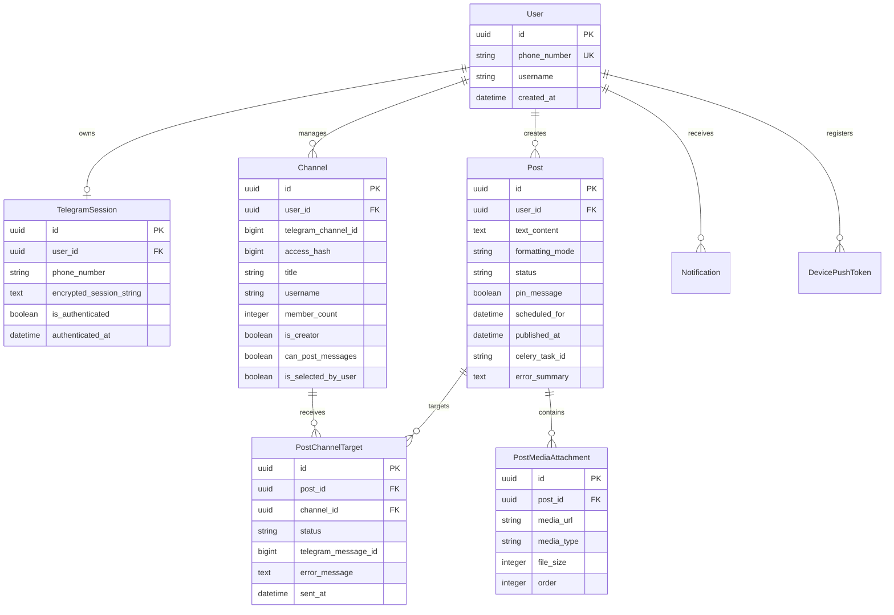

# ⚙️ Postly Backend Service

<p align="center">
  <strong>High-concurrency Django REST API, Telethon MTProto broadcast engine, and Celery asynchronous task worker for Postly.</strong>
</p>

<p align="center">
  
  
  
  
  
  
  
</p>

---

## 📖 Overview

The **Postly Backend** is the core engine powering the Postly platform. It bridges the mobile application with the official **Telegram MTProto Cloud** via **Telethon**, eliminating the limitations and permission restrictions of traditional Telegram bots.

### Core Responsibilities
- **Direct Telegram MTProto Authentication**: Coordinates SMS/in-app login codes, Two-Step Verification (2FA Cloud Passwords), and secure user sessions.
- **Encrypted Session Lifecycle**: Protects user MTProto session strings using military-grade **AES-256 Fernet** symmetric encryption.
- **Channel Discovery & Permission Verification**: Introspects Telegram dialogs to discover channels and supergroups where the user holds posting or administrator privileges.
- **Rich Post Composition & Instant Broadcasting**: Broadcasts formatted HTML/Markdown posts and multi-media albums to target channels with per-channel error isolation.
- **Distributed Scheduling Engine**: Executes scheduled broadcasts via Celery workers with optimistic concurrency control and auto-reconciliation beat workers.
- **In-App Activity Logs**: Records per-channel delivery confirmations, error logs, and activity notifications.

---

## 📂 Architecture & Modular Domain Structure

The backend follows a domain-driven Django structure located under `apps/`:

```
backend/
├── apps/
│   ├── accounts/              # User identity, Knox auth, TelegramSession model & 2FA views
│   │   ├── models.py          # User (custom UUID) and TelegramSession
│   │   ├── serializers.py     # Auth DTO validation schemas
│   │   ├── views.py           # SendCode, VerifyCode, VerifyPassword, Me, Logout
│   │   └── tests.py           # Authentication test suite
│   │
│   ├── channels/              # Channel discovery, permission checks, sync & stats
│   │   ├── models.py          # Channel model (subscriber counts, admin rights, selection)
│   │   ├── serializers.py     # Channel item & stats serializers
│   │   ├── services.py        # TelegramChannelService (Telethon MTProto dialog scanner)
│   │   ├── views.py           # ChannelListView, ChannelSyncView, ChannelStatsView
│   │   └── tests.py           # Channel sync and filtering test suite
│   │
│   ├── posts/                 # Post composer, multi-channel target dispatch, and scheduling
│   │   ├── models.py          # Post, PostChannelTarget, PostMediaAttachment
│   │   ├── serializers.py     # PostCreateSerializer, PostListSerializer, PostDetailSerializer
│   │   ├── services.py        # TelegramPublishingService (MTProto message/album dispatcher)
│   │   ├── tasks.py           # Celery ETA worker tasks & periodic reconciliation beat
│   │   ├── views.py           # PostListCreateView, PostDetailView, PostPublishNowView
│   │   └── tests.py           # Post lifecycle, publish-now, and scheduling tests
│   │
│   ├── notifications/         # Notification logging and in-app activity center
│   │   ├── models.py          # Notification & DevicePushToken models
│   │   ├── serializers.py     # Notification serializers
│   │   ├── services.py        # ExpoPushService & Activity logger
│   │   ├── views.py           # NotificationListView, MarkAsReadView, DeviceRegistrationView
│   │   └── tests.py           # Notification service tests
│   │
│   ├── telegram_engine/       # Low-level Telethon client context managers & cryptographic helpers
│   │   ├── client.py          # Async Telethon client context manager & async runner
│   │   ├── crypto.py          # AES-256 Fernet session encryption & decryption
│   │   ├── services.py        # TelegramAuthService & custom exception models
│   │   └── tests.py           # Cryptography & MTProto error mapping tests
│   │
│   └── common/                # Shared cross-cutting middleware, exceptions, and models
│       ├── exceptions.py      # Standardized API error contract handler
│       ├── middleware.py      # Request ID & structured latency logging middleware
│       ├── models.py          # TimeStampedUUIDModel base class
│       └── pagination.py      # StandardPageNumberPagination helper
│
├── postly_core/               # Core configuration
│   ├── settings.py            # Environment-aware Django settings, CORS, Celery & DB configuration
│   ├── urls.py                # Centralized API v1 URL routing
│   ├── celery.py              # Celery application definition & beat schedule
│   └── wsgi.py / asgi.py      # Application entry points
│
├── manage.py                  # Django CLI
└── requirements.txt           # Production & development dependencies
```

---

## 🗄️ Database Schema & Data Models



---

## 🔒 Security Model

1. **Session Encryption**:
   - Telegram MTProto session strings are encrypted using **Fernet (AES-256 in CBC mode with HMAC-SHA256 authentication)** before saving to PostgreSQL.
   - Decryption occurs only in ephemeral memory within the async client context during active Telegram API calls.
2. **Knox Token Authentication**:
   - Mobile clients authenticate with cryptographically signed Knox tokens.
   - Tokens can be instantly revoked upon user logout.
3. **Optimistic Concurrency Control (OCC)**:
   - Atomic database transactions (`transaction.atomic`) and row-level locking (`select_for_update`) prevent race conditions during concurrent post publishing.
4. **CORS & Security Headers**:
   - Explicit `CORS_ALLOW_METHODS` (`GET, POST, PUT, PATCH, DELETE, OPTIONS`) and secure header protection.

---

## 🛠️ Local Development & Setup

### 1. Prerequisites
- **Python 3.11+** or **3.12+**
- **Redis Server** (Local or Docker: `docker run -d -p 6379:6379 redis:alpine`)
- **Telegram API ID & API Hash** (From [my.telegram.org](https://my.telegram.org))

### 2. Installation Steps

```bash
# 1. Navigate to backend
cd backend

# 2. Create virtual environment
python -m venv .venv

# 3. Activate virtual environment
# Windows (PowerShell):
.venv\Scripts\Activate.ps1
# macOS / Linux:
source .venv/bin/activate

# 4. Install dependencies
pip install -r requirements.txt

# 5. Create .env configuration
cp .env.example .env
# Edit .env and supply your TELEGRAM_API_ID, TELEGRAM_API_HASH, and FERNET_SECRET_KEY

# 6. Apply database migrations
python manage.py migrate

# 7. Run full automated test suite (42 tests)
python manage.py test

# 8. Start Django development server
python manage.py runserver 0.0.0.0:8000
```

### 3. Running Celery Worker & Beat Scheduler

In separate terminal windows with your virtual environment active:

```bash
# Start Celery Worker (Executes scheduled posts & background publishing)
celery -A postly_core worker --loglevel=info

# Start Celery Beat (Reconciles overdue scheduled posts)
celery -A postly_core beat --loglevel=info
```

---

## 📡 REST API Reference

All protected endpoints require the following HTTP Header:
```http
Authorization: Bearer <your_knox_token>
```

### 1. Authentication (`/api/v1/auth/`)
- `POST /api/v1/auth/telegram/send-code/` — Request SMS/Telegram login OTP.
- `POST /api/v1/auth/telegram/verify-code/` — Submit 5-digit OTP; returns token or `requires_password: true`.
- `POST /api/v1/auth/telegram/verify-password/` — Submit Telegram 2FA cloud password.
- `GET /api/v1/auth/me/` — Retrieve user profile and connected Telegram session status.
- `POST /api/v1/auth/logout/` — Terminate session and invalidate auth token.

### 2. Channels (`/api/v1/channels/`)
- `GET /api/v1/channels/` — List discovered channels (supports `?can_post_only=true`, `?selected_only=true`, `?search=query`).
- `POST /api/v1/channels/sync/` — Trigger real-time MTProto channel discovery and permission sync.
- `GET /api/v1/channels/<id>/` — Retrieve channel details.
- `PATCH /api/v1/channels/<id>/toggle-selection/` — Toggle broadcast selection status.
- `GET /api/v1/channels/<id>/stats/` — Fetch delivery success/failure analytics for channel.

### 3. Posts & Scheduling (`/api/v1/posts/`)
- `GET /api/v1/posts/` — List broadcast posts feed (supports `?status=SCHEDULED|PUBLISHED|FAILED`, `?channel_id=uuid`, `?search=text`).
- `POST /api/v1/posts/` — Compose post (`text_content`, `formatting_mode`, `target_channel_ids`, `media_attachments`, `scheduled_for`, `publish_now`, `pin_message`).
- `GET /api/v1/posts/<id>/` — Fetch complete post details, targets, and media attachments.
- `PATCH /api/v1/posts/<id>/` — Update draft or scheduled post.
- `DELETE /api/v1/posts/<id>/` — Delete post and revoke scheduled Celery task.
- `POST /api/v1/posts/<id>/publish-now/` — Immediately dispatch draft or scheduled post.
- `POST /api/v1/posts/<id>/cancel-schedule/` — Cancel scheduled broadcast and revert post to draft.

### 4. Media & Notifications (`/api/v1/`)
- `GET /api/v1/media/upload-signature/` — Generate signed direct-upload params for Cloudinary.
- `POST /api/v1/media/upload/` — Direct media file upload fallback.
- `GET /api/v1/notifications/` — Fetch user activity and delivery notification logs.
- `POST /api/v1/notifications/mark-read/` — Mark all activity notifications as read.
- `POST /api/v1/notifications/devices/` — Register Expo push token.

---

## 🧪 Testing

The backend includes a comprehensive 42-test automated verification suite covering unit, integration, and security scenarios.

```bash
python manage.py test
```

```
Creating test database for alias 'default'...
..........................................
----------------------------------------------------------------------
Ran 42 tests in 4.120s

OK
Destroying test database for alias 'default'...
```
